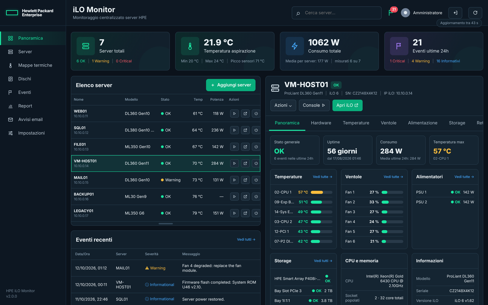
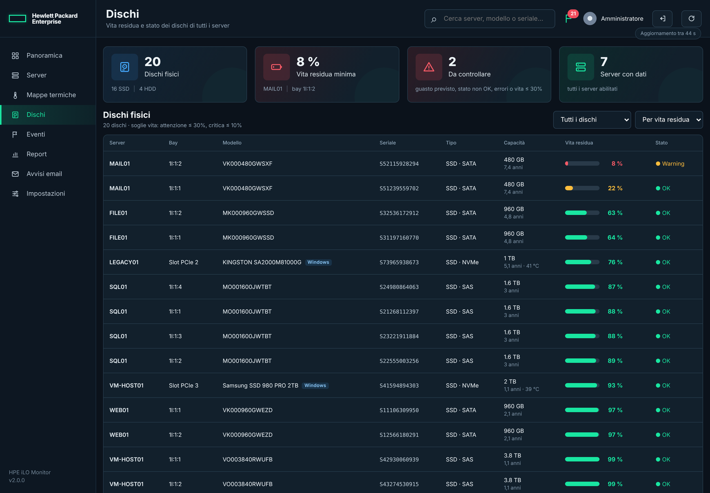
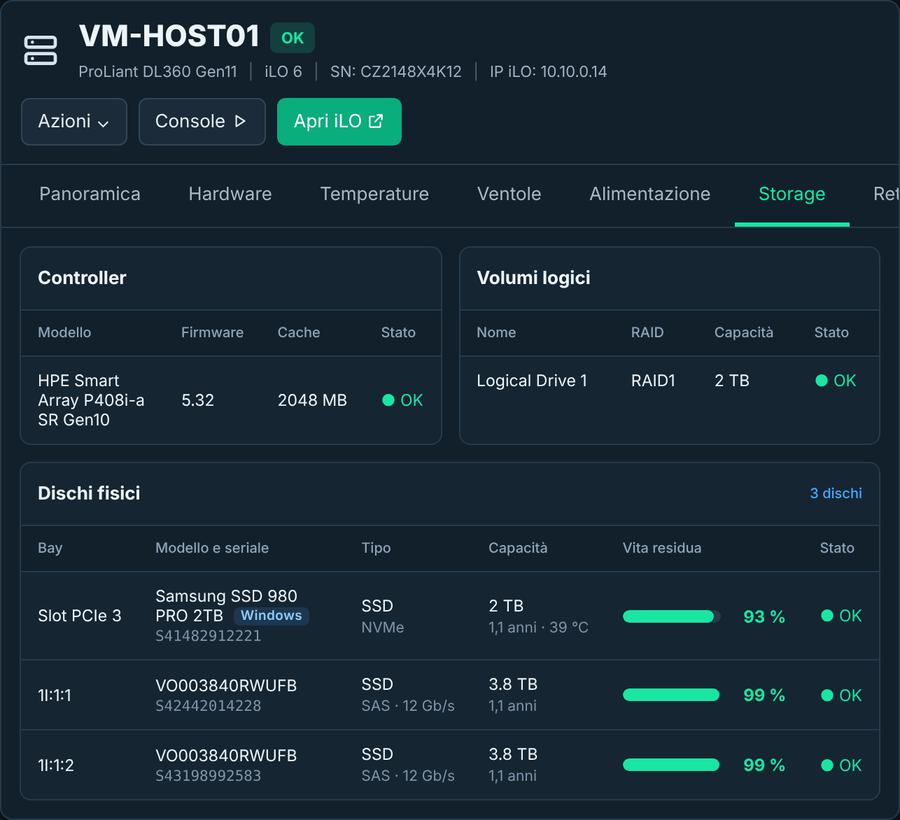
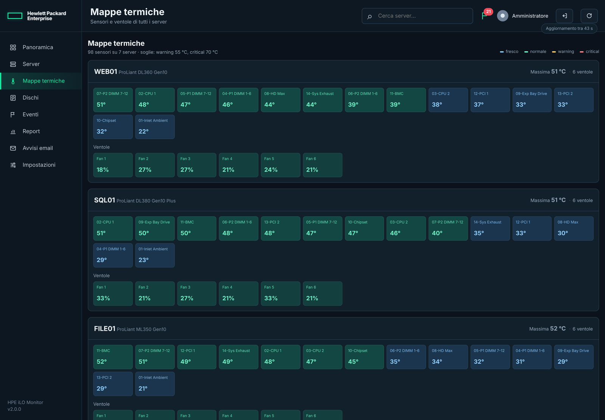
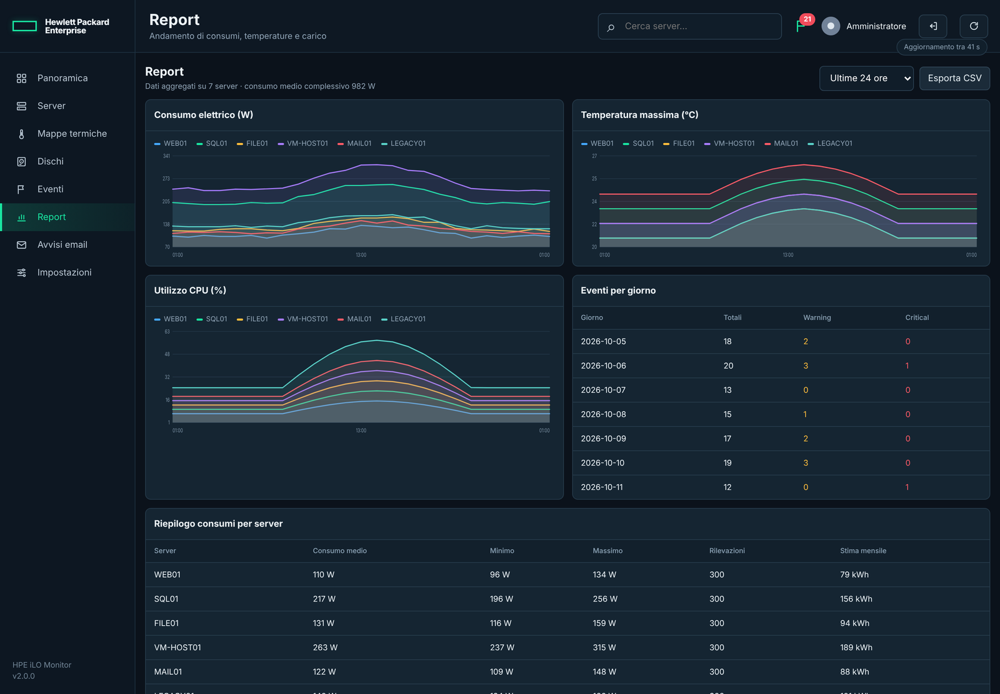
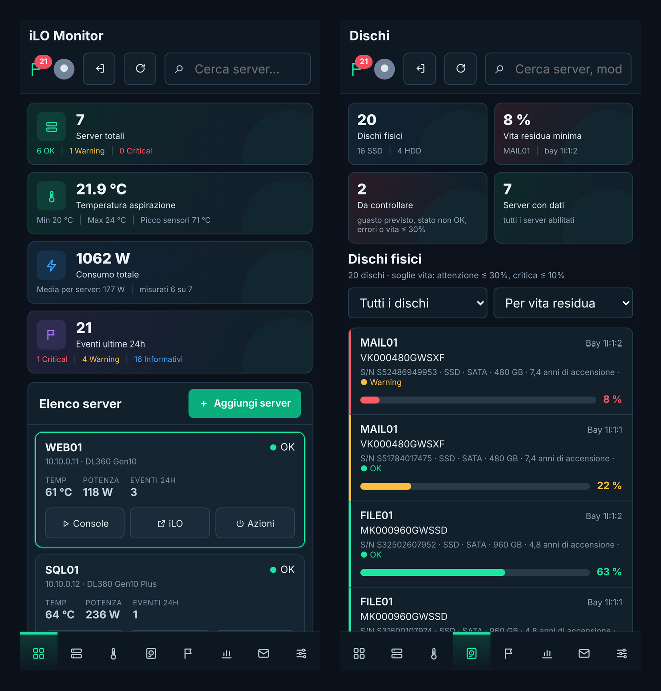

# iLO Monitor

Pannello di monitoraggio centralizzato per server HPE ProLiant.
Raccoglie stato di salute, temperature, ventole, consumi, storage, rete
e log eventi da più iLO, li conserva in un database e li mostra in
un'unica interfaccia web, con avvisi via email.

Parla **Redfish** con gli iLO 4, 5 e 6 e **RIBCL** con i vecchi iLO 2
e 3, che Redfish non lo conoscono. Gestisce anche le **schede di
gestione Redfish di altri produttori** (per esempio ASUS ASMB10-iKVM,
firmware AMI) per accensione, spegnimento, riavvio e registro eventi.
Uno **script per Windows**, generato dal pannello, aggiunge i dischi che
l'iLO non vede (per esempio gli NVMe su scheda PCIe) con i dati SMART
letti direttamente dal disco e, dove la scheda di gestione non li
legge, temperature, ventole e inventario del sistema.

Nato per non dover aprire sette interfacce iLO diverse per sapere come
stanno sette server.

> Progetto indipendente, non affiliato né approvato da Hewlett Packard
> Enterprise. "HPE", "ProLiant" e "iLO" sono marchi dei rispettivi
> titolari.

## Schermate

Le schermate usano server e dati di esempio.



| Dischi di tutti i server, per vita residua | Storage di un server, con un NVMe letto da Windows |
|---|---|
|  |  |

| Mappe termiche | Report |
|---|---|
|  |  |

<p align="center">
  
</p>

## Cosa fa

- **Multi-server.** Ogni iLO ha le sue credenziali, cifrate nel
  database. Un server che non risponde non blocca gli altri.
- **iLO 4, 5 e 6.** Le differenze fra generazioni sono gestite:
  chiave OEM `Hp` o `Hpe`, collezioni `Items` o `Members`, storage
  sotto `Storage` o sotto `SmartStorage`, paginazione dei log.
- **iLO 2 e 3.** Senza Redfish, si leggono via RIBCL (riconosciuti
  da soli all'aggiunta): stato, temperature, ventole, alimentatori,
  consumi, dischi (modello e stato), processori, memoria, registri
  eventi, accensione e LED. L'usura dei dischi e gli indirizzi IP
  del sistema non sono disponibili su queste generazioni.
- **Altre schede di gestione (BMC).** Se all'indirizzo non risponde un
  iLO, il pannello prova il Redfish standard: stato, accensione e
  riavvio, LED, registri eventi e, se la scheda li legge, sensori.
  Vedi [Schede di gestione di altri produttori](#schede-di-gestione-di-altri-produttori).
- **Inventario e stato.** Processori, moduli di memoria, dischi
  fisici e volumi, controller, interfacce di rete, alimentatori,
  sensori termici, ventole, consumi.
- **Dischi.** Una pagina raccoglie i dischi fisici di tutti i server,
  ordinati per vita residua, con seriale, ore di accensione, stato e
  guasti previsti: si vede subito quale SSD sostituire per primo.
- **Dischi e SMART da Windows.** Uno script PowerShell, scaricabile
  dal pannello per ogni server, legge da Windows tutti i dischi fisici
  con usura, vita residua, temperatura, ore di accensione ed errori, e
  li invia ogni ora. Vedi [Script per Windows](#script-per-windows-dischi-e-smart).
- **Eventi.** Importa IEL, IML, SL e Alert Event Log, deduplicati,
  con filtro per server, gravità, sorgente e testo. Gli accessi
  generati dal monitoraggio stesso si possono escludere.
- **Avvisi email.** Per ogni server si sceglie la gravità minima e
  quali categorie seguire, più quattro controlli sullo stato dei
  componenti che avvisano al cambiamento anziché a ripetizione.
- **Azioni.** Accensione, spegnimento ordinato o forzato, riavvio,
  LED di identificazione, apertura della console remota HTML5 (sugli
  iLO 2 e 3 si apre la loro pagina, da cui parte la console Java).
- **Telefono.** Sotto gli 820 pixel l'impaginazione cambia
  impostazione: barra di navigazione in basso, elenco a schede,
  menu che salgono dal basso. Si può aggiungere alla schermata home.

## Avvio rapido con Docker

```bash
git clone https://github.com/Hascanio35/ilo-monitor.git
cd ilo-monitor
cp .env.example .env
$EDITOR .env          # cambia almeno DB_PASSWORD e DB_ROOT_PASSWORD
docker compose up -d
```

Il repository impone i fine riga Unix agli script (`.gitattributes`):
serve perche' girano dentro contenitori Linux anche quando il clone
avviene su Windows.

L'interfaccia risponde su <http://localhost:8080>.

La password del primo accesso viene generata e stampata una sola
volta nei log:

```bash
docker compose logs api | grep -A6 "UTENZA CREATA"
```

In alternativa impostala tu in `.env` con `ADMIN_PASSWORD`.

### Servizi

| Servizio | Ruolo |
|---|---|
| `db` | MariaDB, dati su volume `db-data` |
| `api` | Interfaccia e API, applica lo schema all'avvio |
| `collector` | Interroga gli iLO a intervalli regolari |

`api` e `collector` condividono il volume `config`, che contiene
`secret.key`: **è la chiave che cifra le password degli iLO.**
Perderla significa doverle reinserire tutte. Vale la pena metterla nei
backup.

### Comandi utili

```bash
# raccolta immediata, senza aspettare il ciclo
docker compose exec collector python3 -m app.redfish_collector --full

# elenco dei server configurati e ultimo esito
docker compose exec collector python3 -m app.redfish_collector --list

# diagnostica di un iLO che non risponde come previsto
docker compose exec collector python3 -m app.redfish_collector --dump 3

# gestione degli utenti dell'interfaccia
docker compose exec api ilo-monitor-user list
docker compose exec api ilo-monitor-user add tecnico

# backup del database
docker compose exec db mariadb-dump -u root -p"$DB_ROOT_PASSWORD" \
  ilomonitor > backup.sql
```

## Installazione senza Docker

Per chi preferisce il servizio di sistema, in `install/` ci sono gli
script per Debian e Ubuntu, e in `systemd/` le unità. L'applicazione
va in `/opt/ilo-monitor`, con nginx davanti a uvicorn.

```bash
sudo ./install/upgrade.sh    # prima installazione o passaggio dalla v1
sudo ./install/update.sh     # aggiornamenti successivi
```

## iLO 2 e 3

Si aggiungono come gli altri: il pannello prova Redfish e, se
all'indirizzo risponde un iLO di vecchia generazione, passa da solo a
RIBCL. Ogni giro fa un solo accesso all'iLO per stato e sensori;
inventario e registri, a cadenza oraria, ne aggiungono altri tre.

Gli iLO 2 accettano solo TLS 1.0 con cifrari datati: il collector li
abilita **solo** per le connessioni verso di loro, il resto del sistema
non cambia. Per capire cosa risponde un iLO 2 c'è una prova che salva
le risposte grezze (senza password né chiave di licenza):

```bash
python3 -m app.ribcl --probe 192.168.1.50 --user Administrator
```

Su queste generazioni non sono disponibili l'usura dei dischi, i loro
numeri di serie e gli indirizzi IP del sistema operativo; i consumi
dipendono dagli alimentatori.

## Schede di gestione di altri produttori

Si aggiungono come gli iLO, con indirizzo e credenziali della scheda.
Se non risponde un iLO, il pannello prova il Redfish standard seguendo
le collezioni (`Systems`, `Managers`, `Chassis`) invece dei percorsi
HPE, e se trova un sistema registra il server come "BMC". Provato con
ASUS ASMB10-iKVM (firmware AMI MegaRAC).

Cosa si ottiene:

- accensione, spegnimento ordinato e forzato, riavvio ordinato e
  forzato, con i comandi che la scheda dichiara di accettare;
- LED di identificazione, se la scheda ne ha uno;
- registri eventi (esclusi quelli degli accessi);
- temperature, ventole e consumi, se la scheda li legge;
- il pulsante **Apri BMC**, che porta alla pagina della scheda e al
  suo KVM.

Una scheda montata su una scheda madre che non supporta (per esempio
l'ASMB10 su una scheda madre da PC) non legge nessun sensore: li
riporta tutti come assenti e scrive nel registro falsi guasti agli
alimentatori e soglie di tensione superate. In quel caso il pannello
scarta gli eventi dei sensori e tiene quelli di sistema (accensioni,
spegnimenti, mancanze di corrente); temperature, ventole e inventario
possono arrivare dallo script per Windows.

Per vedere cosa espone una scheda c'e' una diagnostica che salva
l'albero Redfish su file (senza password, account e certificati):

```bash
python3 -m app.redfish_collector --dump <id del server>
```

## Script per Windows: dischi e SMART

L'iLO non vede tutto: gli iLO 2 non conoscono gli NVMe su scheda
PCIe, e senza Agentless Management Service nemmeno gli iLO 5 vedono i
dischi sul SATA integrato. Windows invece li vede tutti.

Dal dettaglio di un server, **Azioni → Script dischi per Windows…**
scarica uno script PowerShell già configurato con l'indirizzo del
pannello e una chiave valida solo per quel server. Sul server, da
PowerShell aperto come amministratore:

```powershell
# prova: mostra i dischi letti, non invia nulla
powershell -ExecutionPolicy Bypass -File .\ilo-monitor-dischi-NOME.ps1 -Mostra

# installazione: attivita' pianificata ogni ora e all'avvio, come SYSTEM
powershell -ExecutionPolicy Bypass -File .\ilo-monitor-dischi-NOME.ps1 -Installa

# rimozione dell'attivita' pianificata
powershell -ExecutionPolicy Bypass -File .\ilo-monitor-dischi-NOME.ps1 -Rimuovi
```

Cosa legge:

- **NVMe**: il registro *SMART / Health Information* e i dati di
  identificazione del controller (percentuale di usura, ore e cicli di
  accensione, temperatura, dati letti e scritti, spegnimenti anomali,
  errori del supporto, riserva disponibile, avviso critico, numero di
  serie reale). Richiede Windows Server 2016 / Windows 10 o successivi.
- **SATA**: gli attributi SMART dal driver di disco (vita residua da
  231, 233, 202, 177 o 169 secondo il produttore, ore, temperatura,
  settori riallocati e in attesa, errori non correggibili) e la
  previsione di guasto.
- In mancanza dei precedenti, i contatori di Windows
  (`Get-StorageReliabilityCounter`).

Sono esclusi i volumi dei controller RAID (quei dischi li legge già
l'iLO), i volumi iSCSI e Fibre Channel, le chiavette USB e i dischi
virtuali. Lo script invia i valori grezzi e li interpreta il pannello:
se un produttore usa un attributo diverso si corregge il pannello,
senza reinstallare nulla sui server.

Nel pannello questi dischi hanno l'etichetta **Windows**; se lo stesso
disco lo vede anche l'iLO compare una volta sola, completata con i dati
SMART. Errori non corretti, settori in attesa, avviso critico NVMe e
previsione di guasto contano fra i dischi da controllare e fanno
partire gli avvisi email. Se si disinstalla lo script, dopo due giorni
i suoi dischi spariscono dall'elenco.

La chiave viene conservata solo come impronta SHA-256; scaricando di
nuovo lo script se ne crea una nuova e quella vecchia smette di
funzionare. Il server Windows deve raggiungere il pannello
all'indirizzo usato dal browser per scaricarlo.

### Sensori e inventario (server con scheda di gestione generica)

Per i server registrati come "BMC" lo script scaricato dal pannello fa
di piu':

- **ogni 5 minuti** invia temperature di CPU, scheda madre, memoria e
  scheda video, giri delle ventole, carico di CPU e memoria e potenza
  della CPU;
- **ogni ora**, con i dischi, invia l'inventario: modello della scheda
  madre, numero di serie, BIOS, sistema operativo, ultimo avvio,
  processori e moduli di memoria.

I sensori si leggono con la libreria di
[LibreHardwareMonitor](https://github.com/LibreHardwareMonitor/LibreHardwareMonitor):
`-Installa` la scarica da sola da nuget.org nella versione per .NET
Framework (quella dei pacchetti del programma e' per .NET 10 e il
PowerShell di Windows non la puo' usare) e la mette in
`C:\ProgramData\iLO-Monitor\lhm-<data>`. Per CPU e scheda madre serve
anche il driver PawnIO:

```powershell
winget install namazso.PawnIO
```

Con `-Mostra` si vede cosa legge, compreso lo stato di PawnIO. Le soglie
di avviso sono fisse per famiglia (CPU 85/100 °C, scheda madre e
memoria 70/85 °C, scheda video 85/95 °C); le soglie che i moduli di
memoria espongono come se fossero temperature vengono scartate. Sulle
schede madri che LibreHardwareMonitor non conosce i sensori della
scheda madre hanno nomi generici ("Temperature #1", "Fan #2").

## Configurazione

Tutto si imposta dall'interfaccia, in Impostazioni e Avvisi email:
soglie di temperatura, frequenza di rilettura di inventario e log,
conservazione dello storico, server SMTP e regole di avviso.

Le variabili d'ambiente servono solo all'avvio e sono documentate in
[`.env.example`](.env.example).

## Utenza iLO consigliata

Per il solo monitoraggio basta un account con privilegio di lettura.
Per le azioni di alimentazione e il LED servono *Virtual Power and
Reset* e *Configure iLO Settings*. Conviene creare un utente dedicato
su ogni iLO invece di usare Administrator: la revoca è immediata se
serve.

## Sicurezza

L'interfaccia richiede autenticazione; le password sono salvate come
hash pbkdf2 con salt, e i tentativi falliti vengono limitati per
indirizzo.

Le password degli iLO sono cifrate nel database, ma la chiave sta
sulla stessa macchina: chi ha accesso amministrativo all'host può
leggerle. Vale la pena trattare l'installazione come un sistema con
credenziali privilegiate.

Il servizio parla HTTP. Su una rete di gestione o dietro VPN è
accettabile; esposto altrove, mettici davanti un reverse proxy con
TLS. Lo stesso vale per lo script per Windows, che invia i dati
all'indirizzo da cui è stato scaricato.

## Requisiti

- Docker con Compose, oppure Python 3.11+, MariaDB 10.6+ e nginx
- iLO raggiungibile via HTTPS dalla macchina che esegue il collector
  (iLO 2: firmware 2.x, consigliato l'ultimo, 2.33)
- Per lo script dei dischi: Windows Server 2012 o successivo
  (2016 o successivo per lo SMART degli NVMe; per i sensori .NET
  Framework 4.7.2 o successivo, il driver PawnIO e accesso a nuget.org
  durante l'installazione)
- Licenza iLO Advanced per la console remota (il monitoraggio
  funziona anche senza)

## Licenza

MIT — vedi [LICENSE](LICENSE).
